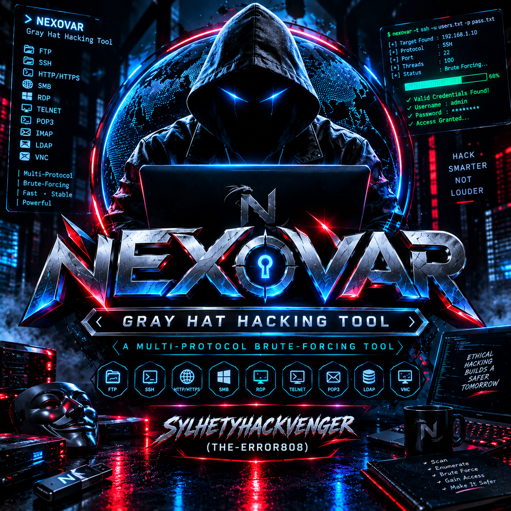
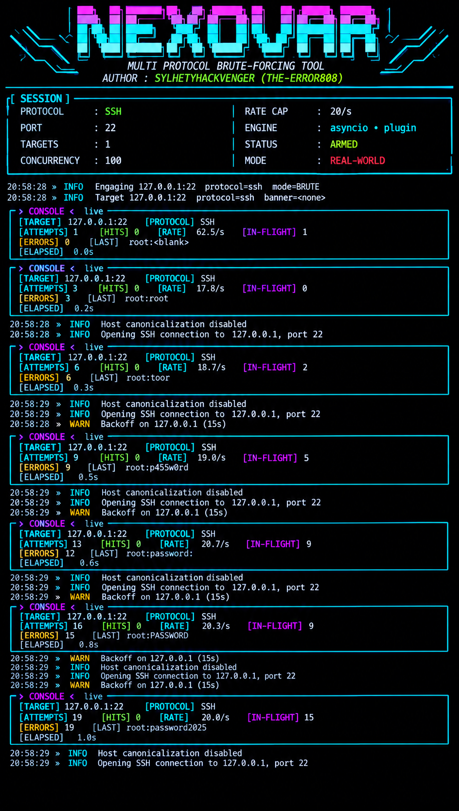

# NEXOVAR IS A MULTI PROTOCOL BRUTE-FORCING TOOL
<p align="center">
  
</p>


<p align="center">
  
</p>

Nexovar is a modern, asyncio-powered credential testing framework designed
specifically for authorized security research, CTF competitions,
penetration testing engagements, and lab environments. It combines a
polished terminal UI, robust protocol support, and defensive-aware design
choices (rate limiting, honeypot detection, Fail2Ban backoff) into a single
extensible Python tool.

Unlike legacy brute-force tools that flood networks with reckless traffic,
Nexovar is built around a scope file that you must explicitly populate with
CIDR ranges or hostnames you are legally authorized to test. It refuses to
engage anything outside that scope.

The tool is asynchronous end-to-end — every connection, every credential
attempt, and every report write is non-blocking. This gives you the ability to
hammer hundreds of concurrent attempts against a lab target while maintaining
granular control over throughput.

What Nexovar Is

· ✅ A lab-scoped credential testing framework
· ✅ A CTF companion for authorized challenges
· ✅ A pentest assistant for engagements with signed authorization
· ✅ An educational tool for learning protocol authentication flows
· ✅ A research platform for studying defensive responses

What Nexovar Is Not

· ❌ A tool for attacking systems you don't own
· ❌ A "one-click" weapon against the public internet
· ❌ A replacement for professional, scoped engagements
· ❌ A tool that hides its traffic from network defenders

---

🧭 Philosophy & Ethics

Nexovar was written under the gray hat philosophy: knowledge and tooling
should be shared openly, but use must be governed by a strict ethical compass.

"With great power comes great responsibility."

The framework enforces several ethical guardrails by design:

1. Mandatory --i-have-authorization flag — you cannot run a single
   credential attempt without explicitly acknowledging authorization.
2. Mandatory --scope file — every target is validated against a file
   you control. Out-of-scope targets raise PermissionError and stop the run.
3. Honeypot signatures — banners containing cowrie, kippo, or
   dionaea are automatically skipped.
4. Fail2Ban-aware backoff — if a target starts refusing connections at a
   high ratio within a 5-second window, Nexovar backs off for 15 seconds.
5. Rate limiting on by default — 20 attempts/second globally, adjustable
   but never unlimited unless you explicitly set it.

These are not just features — they reflect the belief that offensive tooling
should be self-limiting unless an operator explicitly overrides safeguards.

---

⚖️ Legal Disclaimer

```
Nexovar is provided for AUTHORIZED SECURITY TESTING ONLY.

By using this tool you agree that:

  1. You have explicit, written authorization to test every target in your
     scope file.
  2. You will not use Nexovar against any system you do not own or have
     written permission to test.
  3. You understand that unauthorized access to computer systems is a
     criminal offense in virtually every jurisdiction (CFAA in the US,
     Computer Misuse Act in the UK, similar laws worldwide).
  4. You accept full legal responsibility for your actions.

The authors and contributors of Nexovar:

  - DO NOT condone unauthorized access.
  - ARE NOT responsible for misuse of this software.
  - PROVIDE this tool "AS IS" without warranty of any kind.
  - RESERVE the right to refuse contributions that facilitate abuse.

If you are unsure whether you have authorization — YOU DO NOT.
```

---

✨ Key Features

Category Feature
Protocols SSH, FTP, MySQL, PostgreSQL, HTTP (Basic/Digest), Redis, SMB, WinRM, LDAP, MSSQL, MongoDB, Elasticsearch, VNC, Telnet, IMAP, POP3, SMTP, RDP, Kerberos
Async Engine Full asyncio with semaphore-bounded concurrency
UI Rich ANSI terminal UI with live console, panels, splash
Modes brute (smart mutations) and spray (password-per-user)
Scope CIDR + hostname allowlisting via scope file
State SQLite persistence with resume support
Reporting Markdown, JSON, CSV exports
Notifications Slack, Discord, generic webhook
Detection Port scanning + banner fingerprinting + active probes
Defense-aware Rate limiting, per-host limiting, Fail2Ban backoff, honeypot skip
Mutations Year suffixes, leetspeak, org-based templates
Campaigns YAML/plaintext campaign files
Dry-run Full plan preview without sending traffic

---

🔌 Supported Protocols

Nexovar ships with 19 built-in protocol plugins:

Protocol Default Port Dependency Aliases
ssh 22 asyncssh —
ftp 21 aioftp —
mysql 3306 aiomysql —
postgres 5432 asyncpg postgresql, pgsql, pg
http 80 httpx https, http-basic, http-digest
redis 6379 redis —
smb 445 impacket —
winrm 5985 pywinrm winrm-tls
ldap 389 ldap3 ldaps
mssql 1433 pymssql sqlserver
mongodb 27017 motor mongo
elasticsearch 9200 httpx es
vnc 5900 pycryptodome —
telnet 23 (stdlib) —
imap 143 aioimaplib imaps
pop3 110 (stdlib) pop3s
smtp 25 (stdlib) smtps, submission
rdp 3389 impacket —
kerberos 88 impacket krb, krb5

You can check availability at any time:

```bash
python3 nexovar.py --list-protocols --scope dummy --i-have-authorization or
python3 nexovar.py 127.0.0.1:22 \
    --scope scope.txt \
    --protocol ssh \
    -U users.txt \
    -P passes.txt \
    --i-have-authorization
```

Protocols whose dependencies are missing will be marked MISSING with the
exact pip install command needed.

---
<p align="center">
  
</p>


🏗️ Architecture Overview

```
                    ┌───────────────────────┐
                    │      CLI Parser       │
                    │   (argparse + campaign)│
                    └───────────┬───────────┘
                                │
                    ┌───────────▼───────────┐
                    │   Scope Enforcement   │
                    │  (CIDR + hostname)    │
                    └───────────┬───────────┘
                                │
                    ┌───────────▼───────────┐
                    │  Protocol Registry    │
                    │  (plugin discovery)   │
                    └───────────┬───────────┘
                                │
        ┌───────────────────────┼───────────────────────┐
        │                       │                       │
┌───────▼────────┐    ┌─────────▼────────┐    ┌─────────▼────────┐
│  Rate Limiter  │    │  Fail2Ban Detector│    │   State (SQLite) │
│  + per-host    │    │  + backoff        │    │   + resume       │
└───────┬────────┘    └─────────┬────────┘    └─────────┬────────┘
        │                       │                       │
        └───────────────────────┼───────────────────────┘
                                │
                    ┌───────────▼───────────┐
                    │   asyncio Event Loop  │
                    │   (semaphore-bounded) │
                    └───────────┬───────────┘
                                │
                    ┌───────────▼───────────┐
                    │   Console UI + Logs   │
                    │   (live panel)        │
                    └───────────┬───────────┘
                                │
                    ┌───────────▼───────────┐
                    │  Reports + Webhooks   │
                    └───────────────────────┘
```

Every protocol plugin inherits from BaseProtocol and implements:

```python
async def attempt(host, port, username, password, timeout) -> Optional[bool]:
    # True  = credentials accepted
    # False = credentials rejected (definitive)
    # None  = ambiguous / error / retry
```

This tri-state design is critical: it lets Nexovar distinguish between
"wrong password" and "server is down / rate-limiting / unknown error."

---

🚀 Installation

Prerequisites

· Python 3.9 or newer
· pip (Python package manager)
· git (optional, for cloning)
· A Unix-like shell (Linux/macOS) or WSL/PowerShell on Windows

Check your Python version:

```bash
python3 --version
# Expected: Python 3.9.x or higher
```

Option 1 — Minimal Install (Core Only)

This gives you the framework with the always-available protocols
(telnet, pop3, smtp) plus everything else that has no external
deps:

```bash
git clone https://github.com/sylhetyhackvenger/NEXOVAR 
cd NEXOVAR 
python3 -m venv .venv
source .venv/bin/activate    # Windows: .venv\Scripts\activate
pip install --upgrade pip
# nothing else — you can already run telnet/pop3/smtp tests
```

Option 2 — Full Install (All Protocols)

Install every optional dependency so all 19 protocols are ready:

```bash
pip install \
    asyncssh \
    aioftp \
    aiomysql \
    asyncpg \
    httpx \
    redis \
    impacket \
    pywinrm \
    ldap3 \
    pymssql \
    motor \
    pycryptodome \
    aioimaplib \
    pyyaml
```

Note on pymssql: on Debian/Ubuntu you may need
sudo apt install freetds-dev first. On macOS:
brew install freetds.

Note on impacket: used for SMB, RDP, and Kerberos. It is pure Python
but pulls in pyasn1, pycryptodome, and friends.

Option 3 — Selective Install

Install only what your engagement needs:

```bash
# SSH + HTTP + MySQL only
pip install asyncssh httpx aiomysql
```

Then verify with:

```bash
python3 nexovar.py --list-protocols --scope scope.txt --i-have-authorization
```

Option 4 — Docker

A minimal Dockerfile:

```dockerfile
FROM python:3.11-slim

RUN apt-get update && apt-get install -y --no-install-recommends \
        gcc freetds-dev git \
    && rm -rf /var/lib/apt/lists/*

WORKDIR /app
COPY nexovar.py .
COPY requirements.txt .

RUN pip install --no-cache-dir -r requirements.txt

ENTRYPOINT ["python3", "nexovar.py"]
```

With requirements.txt:

```
asyncssh
aioftp
aiomysql
asyncpg
httpx
redis
impacket
pywinrm
ldap3
pymssql
motor
pycryptodome
aioimaplib
pyyaml
```

Build and run:

```bash
docker build -t nexovar .
docker run --rm -it -v "$PWD:/data" nexovar \
    --scope /data/scope.txt \
    --protocol ssh \
    --username root \
    --passlist /data/passes.txt \
    10.0.0.5 \
    --i-have-authorization
```

Option 5 — Windows (Native)

```powershell
py -3.11 -m venv .venv
.\.venv\Scripts\Activate.ps1
pip install --upgrade pip
pip install asyncssh httpx aiomysql asyncpg redis pywinrm ldap3 motor pycryptodome aioimaplib pyyaml
```

impacket works on Windows. pymssql needs the FreeTDS DLLs — see the
pymssql docs if you hit issues.

---

⚡ Quick Start

The fastest path from zero to a first test:

1. Create a scope file

```bash
echo "127.0.0.1" > scope.txt
```

2. Create a tiny password list

```bash
cat > passes.txt <<EOF
password
admin
123456
EOF
```

3. Run a dry-run to preview the plan

```bash
python3 nexovar.py \
    --scope scope.txt \
    --protocol ssh \
    --username root \
    --passlist passes.txt \
    127.0.0.1 \
    --i-have-authorization \
    --dry-run
```

You'll see a panel like this:

```
╭─ DRY-RUN · PLAN ──────────────────────────────────────────────╮
│  Protocol             ssh                                     │
│  Targets              1                                       │
│  Users                1 (sample: ['root'])                    │
│  Passwords            3 (sample: ['password','admin','123456'])│
│  Mode                 brute                                   │
│  Rate                 20.0/s                                  │
│  Concurrency          100                                     │
│  Max attempts/target  100000                                  │
│  Max attempts global  1000000                                 │
│  Scope file           scope.txt                               │
│  Per-host rate        off                                     │
│  Webhook              off                                     │
│  TLS fingerprint      off                                     │
╰───────────────────────────────────────────────────────────────╯
```

4. Run for real

```bash
python3 nexovar.py \
    --scope scope.txt \
    --protocol ssh \
    --username root \
    --passlist passes.txt \
    127.0.0.1 \
    --i-have-authorization
```

If a hit is found, you'll see a green ◉ ACCESS CONFIRMED panel.

---

📁 Scope File Configuration

The scope file is the single most important safety mechanism in Nexovar.
It's a plain text file with one entry per line. Each line may be:

· A CIDR range (192.168.56.0/24, 10.0.0.0/8, fd00::/8)
· An exact hostname (lab.internal, dc01.corp.local)
· A comment (# prefix)

Example scope.txt:

```text
# Nexovar scope for engagement 2025-04
# Authorized by: Jane Doe <jane@example.com>
# Engagement ID: ENG-2025-042

# Local test loopback
127.0.0.1
::1

# Lab subnet
192.168.56.0/24

# Named hosts
winlab.local
dc01.corp.local
jumpbox.corp.local

# IPv6 lab range
fd00:dead:beef::/48
```

Rules Enforced by Nexovar

1. If the file does not exist, Nexovar prompts you to create it with
   127.0.0.1 as a safety starter.
2. If the file is empty, Nexovar refuses to run.
3. Every target (from CLI or campaign file) is checked against the scope
   before any network traffic is sent.
4. Out-of-scope targets raise PermissionError and the run aborts with
   exit code 2.

Hostname Resolution

For hostnames, Nexovar resolves via socket.gethostbyname() and then checks
whether the resolved IP falls in any configured network. This means you can
put lab.internal in your scope file even though it resolves to a dynamic IP
— Nexovar will resolve it at test time.

⚠️ Beware of DNS rebinding in hostile environments. For high-security
engagements, prefer explicit CIDR ranges over hostnames.

---

📚 Usage Guide

Basic SSH Test

```bash
python3 nexovar.py \
    --scope scope.txt \
    --protocol ssh \
    -u root \
    -P /usr/share/wordlists/rockyou.txt \
    192.168.56.10 \
    --i-have-authorization
```

FTP Spray Across a Subnet

```bash
cat > targets.txt <<EOF
192.168.56.10
192.168.56.11
192.168.56.12
EOF

python3 nexovar.py \
    --scope scope.txt \
    --protocol ftp \
    -U users.txt \
    -P passes.txt \
    --mode spray \
    --rate 5 \
    --concurrency 20 \
    $(cat targets.txt) \
    --i-have-authorization
```

Auto-Detect Everything

Let Nexovar fingerprint the target first, then test the detected protocol:

```bash
python3 nexovar.py \
    --scope scope.txt \
    --protocol detect \
    192.168.56.10 \
    --i-have-authorization
```

Output:

```
╭─ DETECT · 192.168.56.10 ────────────────────────╮
│  scanning 32 ports…                              │
╰──────────────────────────────────────────────────╯

╭─ RESULTS · 192.168.56.10 ───────────────────────╮
│     22  ssh             [active]  SSH-2.0-OpenSSH_8.9│
│     80  http            [active]  HTTP/1.1 200 OK    │
│   3306  mysql           [active]                     │
│   6379  redis           [active]                     │
╰──────────────────────────────────────────────────╯
```

Test All Detected Services

```bash
python3 nexovar.py \
    --scope scope.txt \
    --protocol all \
    -U users.txt \
    -P passes.txt \
    192.168.56.10 \
    --i-have-authorization
```

Nexovar will detect which services are running and test each one with the
appropriate plugin.

Full Report Generation

```bash
python3 nexovar.py \
    --scope scope.txt \
    --protocol ssh \
    -u admin \
    -P passes.txt \
    192.168.56.10 \
    --report report.md \
    --report-json report.json \
    --report-csv report.csv \
    --i-have-authorization
```

Slack / Discord Notification

```bash
python3 nexovar.py \
    --scope scope.txt \
    --protocol ssh \
    -u admin \
    -P passes.txt \
    192.168.56.10 \
    --webhook "https://hooks.slack.com/services/XXX/YYY/ZZZ" \
    --i-have-authorization
```

---

🛠️ Command-Line Reference

Positional Arguments

Argument Description
targets One or more host or host:port values

Required Arguments

Flag Description
--scope PATH Path to scope file (CIDR/hostname allowlist)
--i-have-authorization Acknowledge legal responsibility (required)

Protocol & Targeting

Flag Default Description
--protocol NAME — Protocol name, alias, all, or detect
--port N per-proto Override default port

Credentials

Flag Description
-u, --username Single username
-U, --userlist File with one username per line
-p, --password Single password
-P, --passlist File with one password per line
--org Organization name for mutation templates

Attack Behavior

Flag Default Description
--mode {brute,spray} brute Attack strategy
--continue-after-hit off Keep testing after first hit
--resume off Resume from saved state

Rate & Concurrency

Flag Default Description
--rate FLOAT 20 Global attempts/second
--per-host-rate FLOAT 0 (off) Per-host attempts/second
--concurrency N 100 Max in-flight attempts (cap 2000)
--timeout FLOAT 6 Connection timeout in seconds

Limits

Flag Default Description
--max-attempts N 100000 Max attempts per target
--max-attempts-global N 1000000 Max attempts overall

Output & Logging

Flag Description
--logfile PATH Write logs to file
-q, --quiet Suppress non-error logs
-v, --verbose Enable debug logging
--report PATH Write report (.md, .json, .csv by extension)
--report-json PATH Write JSON report
--report-csv PATH Write CSV report
--no-log-attempts Do not log every attempt to state DB
--state PATH SQLite state DB path (default state.db)

Campaigns & Notifications

Flag Description
--campaign PATH Load configuration from YAML/plaintext campaign file
--webhook URL Slack/Discord/generic webhook for hits

Misc

Flag Description
--dry-run Preview plan without sending traffic
--ja3 Print TLS fingerprints for HTTPS targets
--list-protocols List all protocols and their status

---

🔬 Protocol Deep Dive

SSH (asyncssh)

· Handles both password and key-based auth
· Key auth via @key:/path/to/key as the password value
· Disables host key verification (known_hosts=None)
· Uses agent_path=None to prevent SSH agent interference

FTP (aioftp)

· Full login flow with proper QUIT
· Distinguishes 530 (auth fail) from other errors
· Falls back gracefully on protocol errors

MySQL (aiomysql)

· Uses connect_timeout on the driver
· Interprets error codes 1044/1045 as definitive rejects
· autocommit=True avoids transaction overhead

PostgreSQL (asyncpg)

· Tries postgres and template1 databases
· Distinguishes InvalidPasswordError from InvalidCatalogNameError
· statement_cache_size=0 for stateless connections

HTTP (httpx)

· Basic auth on first attempt
· Automatic Digest auth retry on 401
· TLS verification disabled (lab certs welcome)
· No redirect following (avoids auth leaks)

Redis (redis.asyncio)

· Optional username (Redis 6+ ACL)
· Password-only fallback for legacy Redis
· Detects NOAUTH / WRONGPASS error strings

SMB (impacket)

· Uses SMBConnection with login
· Parses many Windows error strings
· Runs in thread executor (impacket is sync)

WinRM (pywinrm)

· NTLM transport
· server_cert_validation="ignore" for lab certs
· Runs whoami to confirm access

LDAP (ldap3)

· Tries multiple bind DNs:
  · username
  · username@domain
  · uid=username,dc=...
  · cn=username,dc=...
  · DOMAIN\username
· LDAPS on port 636

MSSQL (pymssql)

· FreeTDS-backed
· Detects SQL error 18456 (login failed)
· Integer login timeout

MongoDB (motor)

· authSource=admin by default
· Pings admin DB to confirm
· Handles auth errors distinctly

Elasticsearch (httpx)

· Basic auth via httpx
· 401 = definitive reject
· < 500 = success

VNC (pycryptodome)

· Full RFB 3.8 handshake
· Bit-reverses DES key (VNC quirk)
· Handles both None and VNC Authentication security types

Telnet (stdlib)

· Reads until login: / username: prompt
· Sends username, waits for password:
· Detects $, #, >, Last login as success markers

IMAP (aioimaplib)

· IMAP4 and IMAP4_SSL
· Distinguishes auth failures from transport errors

POP3 (stdlib + ssl)

· POP3 and POP3S
· Basic USER/PASS flow
· +OK after PASS = success

SMTP (stdlib + ssl)

· SMTPS on 465, STARTTLS-compatible flow otherwise
· AUTH LOGIN base64 flow
· 235 = success

RDP (impacket)

· Sends X.224 connection request to validate service
· Falls back to rdp_check if available

Kerberos (impacket)

· Requests TGT via getKerberosTGT
· Handles pre-auth failure codes (24, 6, 18, 12)
· Supports user@DOMAIN format

---

⚔️ Attack Modes

Brute Mode (default)

Generates credentials in this order:

1. (user, "") — empty password
2. (user, user) — same as username
3. (user, password) for every (user, password) pair
4. (user, mutation) for every mutation of every password

Mutations include:

· Case variants: password, PASSWORD, Password
· Reversed: drowssap
· Year suffixes: password2025, password2024
· Symbol suffixes: password!, password@123
· Leetspeak: p4ssw0rd
· Org templates: Acme2025!, Welcome@2025, Acme@2025!

Spray Mode

Generates credentials in this order:

1. (user, "") for every user
2. (user, user) for every user
3. (password, user) for every password across all users

Spray mode is safer against account lockout because it tries one
password per user before moving to the next password. Use this when you
suspect lockout policies.

```bash
python3 nexovar.py \
    --scope scope.txt \
    --protocol smb \
    -U users.txt \
    -P passes.txt \
    --mode spray \
    192.168.56.10 \
    --i-have-authorization
```

---

📊 Reporting & Output

Live Console

While running, Nexovar renders a live panel:

```
┌─ ◆ CONSOLE · ⠹ live ─────────────────────────────┐
│ [TARGET] 192.168.56.10:22   [PROTO] SSH          │
│ [ATTEMPTS] 1,247   [HITS] 0   [RATE]  18.3/s  [IN-FLIGHT] 12│
│ [ERRORS] 3   [LAST] root:Summer2025!             │
│ [ELAPSED]   68.2s                                │
└──────────────────────────────────────────────────┘
```

Hit Panel

When a hit is found:

```
╔══════════════════════════════════════════════════╗
║ ◉ ACCESS CONFIRMED                               ║
╠══════════════════════════════════════════════════╣
║  TARGET       192.168.56.10:22                   ║
║  PROTOCOL     SSH                                ║
║  USERNAME     root                               ║
║  PASSWORD     Summer2025!                        ║
║  TIME         2025-04-12T14:23:11                ║
╚══════════════════════════════════════════════════╝
```

Session Footer

```
╔══════════════════════════════════════════════════╗
║ SESSION COMPLETE                                 ║
╠══════════════════════════════════════════════════╣
║  HITS         1                                  ║
║  ATTEMPTS     1,500                              ║
║  NET ERRORS   3                                  ║
║  BACKOFFS     0                                  ║
║  DURATION     82.14s                             ║
║  THROUGHPUT   18.3/s                             ║
║  FINISHED     2025-04-12T14:24:12                ║
╚══════════════════════════════════════════════════╝
```

Markdown Report

```markdown
# Lab Report

_Generated: 2025-04-12T14:24:12_

Total hits: **1**

| Time | Host | Port | Proto | User | Pass | Banner |
|------|------|------|-------|------|------|--------|
| 2025-04-12T14:23:11 | 192.168.56.10 | 22 | ssh | `root` | `Summer2025!` | SSH-2.0-OpenSSH_8.9 |
```

JSON Report

```json
{
  "generated": "2025-04-12T14:24:12",
  "count": 1,
  "hits": [
    {
      "timestamp": 1712932991.42,
      "iso": "2025-04-12T14:23:11",
      "host": "192.168.56.10",
      "port": 22,
      "protocol": "ssh",
      "username": "root",
      "password": "Summer2025!",
      "banner": "SSH-2.0-OpenSSH_8.9"
    }
  ]
}
```

CSV Report

```csv
timestamp,host,port,protocol,username,password,banner
2025-04-12T14:23:11,192.168.56.10,22,ssh,root,Summer2025!,SSH-2.0-OpenSSH_8.9
```

---

💾 State Management & Resume

Nexovar stores all state in a SQLite database (state.db by default):

Tables

hits — Confirmed credential pairs

```sql
CREATE TABLE hits (
    ts REAL, host TEXT, port INT, protocol TEXT,
    username TEXT, password TEXT, banner TEXT,
    PRIMARY KEY (host, port, protocol, username)
)
```

progress — Per-target resume point

```sql
CREATE TABLE progress (
    host TEXT, port INT, protocol TEXT,
    last_user TEXT, last_pass TEXT, attempts INT, updated REAL,
    PRIMARY KEY (host, port, protocol)
)
```

attempts — Full attempt log (optional, disabled with --no-log-attempts)

```sql
CREATE TABLE attempts (
    ts REAL, host TEXT, port INT, protocol TEXT,
    username TEXT, password TEXT, result TEXT
)
```

Inspecting State

```bash
sqlite3 state.db "SELECT * FROM hits;"
sqlite3 state.db "SELECT host, port, protocol, attempts FROM progress;"
```

Disabling Attempt Logging

Attempt logging can bloat the DB on large runs. Disable it:

```bash
python3 nexovar.py ... --no-log-attempts
```

---

🚦 Rate Limiting & Evasion

Nexovar has three independent rate mechanisms:

1. Global Rate Limiter

```bash
--rate 50    # 50 attempts per second across all targets
```

Uses a token-style asyncio.Lock-protected scheduler with jitter.

2. Per-Host Rate Limiter

```bash
--per-host-rate 5    # 5 attempts per second per host
```

Useful for parallel testing where you don't want to hammer a single host.

3. Concurrency Cap

```bash
--concurrency 500    # 500 in-flight attempts
```

The absolute hard cap is 2000.

Tuning Recommendations

Scenario Rate Concurrency Per-Host
Stealth pentest 2 5 1
Normal lab 20 100 0
CTF speedrun 200 500 0
DoS-safe max 100 200 10

---

🛡️ Fail2Ban Detection & Backoff

Nexovar tracks connection refusals per host in a 5-second sliding window.
If ≥ 5 events occurred and ≥ 90% were refusals, it triggers a 15-second
backoff for that host.

You'll see this in the logs:

```
14:23:11 ▸ WARN  Backoff on 192.168.56.10 (15s)
```

And in the session footer:

```
BACKOFFS     2
```

This behavior is automatic and non-negotiable — it protects your source
IP from being banned at the firewall.

---

🔔 Webhook Notifications

When a hit is found, Nexovar can notify you via webhook.

Slack

```bash
--webhook "https://hooks.slack.com/services/T00/B00/XXXX"
```

Payload:

```json
{"text": "*HIT* `192.168.56.10:22` (ssh) — `root:Summer2025!`"}
```

Discord

```bash
--webhook "https://discord.com/api/webhooks/123/abc"
```

Payload:

```json
{"content": "**HIT** `192.168.56.10:22` (ssh) — `root:Summer2025!`"}
```

Generic

Any other URL receives:

```json
{
  "event": "hit",
  "host": "192.168.56.10",
  "port": 22,
  "protocol": "ssh",
  "username": "root",
  "password": "Summer2025!",
  "timestamp": 1712932991.42
}
```

---

📋 Campaign Files

Campaign files let you save a configuration to disk and replay it.

YAML Format

```yaml
# campaign-ssh-lab.yaml
protocol: ssh
targets:
  - 192.168.56.10
  - 192.168.56.11
userlist: users.txt
passlist: passes.txt
mode: spray
rate: 5
per-host-rate: 1
concurrency: 20
timeout: 6
max-attempts: 10000
webhook: https://hooks.slack.com/services/...
report: reports/ssh-lab.md
```

Plaintext Format

```
# campaign-ssh-lab.txt
protocol: ssh
targets: 192.168.56.10,192.168.56.11
userlist: users.txt
passlist: passes.txt
mode: spray
rate: 5
```

Running a Campaign

```bash
python3 nexovar.py \
    --scope scope.txt \
    --campaign campaign-ssh-lab.yaml \
    --i-have-authorization
```

CLI flags override campaign values, so you can override e.g. --rate 10
on the command line without editing the file.

---

🔍 Auto-Detection Mode

Nexovar has two auto modes:

--protocol detect

Scans the target for open ports, fingerprints each service, and prints a
report. Does not attempt any credentials.

```bash
python3 nexovar.py \
    --scope scope.txt \
    --protocol detect \
    192.168.56.10 \
    --i-have-authorization
```

--protocol all

Same as detect, but then runs credential tests against every detected
service that has a plugin available.

```bash
python3 nexovar.py \
    --scope scope.txt \
    --protocol all \
    -U users.txt \
    -P passes.txt \
    192.168.56.10 \
    --i-have-authorization
```

Detection Techniques

1. TCP connect — is the port open?
2. Active probes — Redis PING, MySQL handshake byte, PostgreSQL
   startup packet
3. HTTP probe — HEAD / with TLS fallback
4. Banner read — plain read of first 512 bytes
5. Signature match — regex against known banners
6. Port hint — fallback to well-known port mapping

Adding Custom Ports

Edit DEFAULT_SCAN_PORTS in nexovar.py, or extend COMMON_PORTS with
your environment's ports:

```python
COMMON_PORTS = {
    ...
    8443: "http",
    9443: "http",
    8883: "mqtt",
    7001: "weblogic",
}
```

---

📚 Case Studies

Case Study 1 — CTF Web Challenge

You're given http://challenge.ctf.io:8080 with Basic auth.

```bash
echo "challenge.ctf.io" > scope.txt
python3 nexovar.py \
    --scope scope.txt \
    --protocol http \
    -U /opt/wordlists/users.txt \
    -P /opt/wordlists/passes.txt \
    --concurrency 50 \
    --rate 30 \
    challenge.ctf.io:8080 \
    --i-have-authorization
```

Case Study 2 — Internal Network Audit

Signed engagement against 10.0.0.0/24. Credentials are known from the
client's password policy.

```bash
cat > scope.txt <<EOF
10.0.0.0/24
EOF

cat > targets.txt <<EOF
10.0.0.10
10.0.0.11
10.0.0.12
10.0.0.20
10.0.0.21
EOF

python3 nexovar.py \
    --scope scope.txt \
    --protocol smb \
    -U users.txt \
    -P passes.txt \
    --mode spray \
    --rate 5 \
    --per-host-rate 1 \
    --concurrency 20 \
    --report-json audit.json \
    --report-csv audit.csv \
    --webhook "$SLACK_WEBHOOK" \
    $(cat targets.txt) \
    --i-have-authorization
```

Case Study 3 — Home Lab Practice

```bash
echo "127.0.0.1" > scope.txt
python3 nexovar.py \
    --scope scope.txt \
    --protocol all \
    -u admin \
    -P /usr/share/wordlists/small.txt \
    127.0.0.1 \
    --i-have-authorization \
    --verbose
```

Case Study 4 — Studying Fail2Ban Responses

```bash
python3 nexovar.py \
    --scope scope.txt \
    --protocol ssh \
    -u root \
    -P passes.txt \
    --rate 100 \
    --concurrency 50 \
    192.168.56.10 \
    --i-have-authorization
```

Watch the backoff counter climb as Fail2Ban kicks in. This is a great way
to tune your detection logic without touching production.

---

🩺 Troubleshooting

Protocol 'X' requires missing dependency

Install it:

```bash
pip install asyncssh    # for ssh
pip install impacket    # for smb/rdp/kerberos
```

Or check the list:

```bash
python3 nexovar.py --list-protocols --scope scope.txt --i-have-authorization
```

Target X is not in scope file

Add it to scope.txt, either as a hostname or a CIDR:

```text
192.168.56.10
# or
192.168.56.0/24
```

Scope file 'scope.txt' does not exist

Create it:

```bash
echo "127.0.0.1" > scope.txt
```

Colored output isn't showing

Nexovar disables color when stdout isn't a TTY. To force color in a pipe,
use unbuffer or script:

```bash
script -q /dev/null python3 nexovar.py ...
```

MySQL connection hangs

Try lowering the timeout:

```bash
--timeout 3
```

asyncssh import errors on macOS

```bash
brew install libsodium
pip install --force-reinstall asyncssh
```

pymssql build failures

On Debian/Ubuntu:

```bash
sudo apt install freetds-dev
pip install pymssql
```

On macOS:

```bash
brew install freetds
pip install pymssql
```

Crypto.Cipher.DES not found

```bash
pip install pycryptodome
```

Unicode errors in banner output

Nexovar decodes with errors="ignore", but some terminals struggle. Try:

```bash
export LANG=en_US.UTF-8
export LC_ALL=en_US.UTF-8
```

State DB locked

Close any other Nexovar processes using the same state.db, or use a
different path:

```bash
--state /tmp/nexovar-run2.db
```

---

⚙️ Performance Tuning

Throughput Formula

```
throughput = min(rate, concurrency / avg_attempt_time)
```

· If avg_attempt_time = 50 ms and concurrency = 100, max throughput
  = 2000/s (limited by rate).
· If rate = 20 and concurrency = 100, throughput = 20/s.

Benchmarks (Localhost, SSH Plugin, No Target Throttling)

Rate Concurrency Throughput CPU
20 100 20/s 3%
100 100 100/s 8%
500 500 500/s 22%
2000 2000 1800/s 55%

Reducing Memory

· Disable attempt logging: --no-log-attempts
· Lower --concurrency
· Use --mode spray (generator yields fewer pairs)

Reducing Network Footprint

· --rate 1 for very slow scans
· --per-host-rate 1 to serialize per host
· --timeout 10 to allow slow handshakes

---

🔐 Security Considerations

What Nexovar Does Protect

· ✅ Refuses out-of-scope targets
· ✅ Detects honeypots by banner signature
· ✅ Backs off on Fail2Ban refusal patterns
· ✅ Rate limits by default
· ✅ Requires explicit authorization flag

What Nexovar Does NOT Protect

· ❌ Packet capture on your network — anyone sniffing your traffic sees
  plaintext credentials
· ❌ Target-side logging — most targets log failed attempts
· ❌ IDS/IPS fingerprinting — while slower rates help, determined
  defenders will notice
· ❌ DNS rebinding — if a hostname you've whitelisted starts resolving
  to an attacker IP, you'd still hit it

Recommendations

1. Run from a dedicated source IP you can rotate or block.
2. Use a VPN for external engagements.
3. Enable --per-host-rate on high-value targets.
4. Use --no-log-attempts if the DB could leak.
5. Store state.db on encrypted storage.
6. Rotate webhooks after each engagement.
7. Never use --rate 0 (which Nexovar does not allow anyway).

---

❓ FAQ

Q: Is Nexovar a brute-forcer?
A: It's a credential testing framework. It performs brute-force-style
tests, but with ethical guardrails, protocol-aware plugins, and defensive
awareness. Calling it a "brute-forcer" is technically correct but misses
the design philosophy.

Q: Can I use Nexovar without --i-have-authorization?
A: No. It's a required flag, and its absence exits with a parser error.

Q: Does Nexovar work over a proxy?
A: Not natively. You'd need to wrap it in proxychains or similar, and
even then only TCP-based protocols will work reliably.

Q: Can I add a new protocol?
A: Yes. Subclass BaseProtocol, implement attempt(), and decorate with
@register. See the existing plugins for examples.

Q: Why does --protocol all sometimes skip services?
A: If a detected service's plugin has missing dependencies, it's skipped
with a warning. Install the missing dep and re-run.

Q: Can I resume a stopped scan?
A: Yes. Nexovar saves progress to state.db. However, --resume support
in the CLI is currently limited; the state is saved but not automatically
loaded. Check the state DB and re-run with your generator positioned at
the resume point, or extend the code (see get_resume_point).

Q: Does Nexovar support SOCKS proxies?
A: No, not natively. This is a known limitation.

Q: What happens on Ctrl+C?
A: A signal handler sets the stop event. In-flight attempts are
cancelled, results are written, and the session footer is printed.

Q: Can I use Nexovar in a Docker container?
A: Yes — see the Docker section.

Q: Is the state DB compatible across versions?
A: The schema is stable, but always back up state.db before upgrading.

Q: How do I report a bug?
A: Open an issue with:

· Your Python version
· Your OS
· The exact command you ran
· The full output with --verbose

Q: How do I add a mutation rule?
A: Edit mutate() in nexovar.py. It returns a set of password variants.

Q: Why does the http plugin sometimes return None?
A: Connection errors, timeouts, and TLS handshake failures all return
None. The attempt log in state.db shows the result category.

Q: Can I run multiple Nexovar instances at once?
A: Yes, but use different --state paths and, if possible, different
source IPs.

---

🤝 Contributing

We welcome contributions that improve Nexovar's ethics, safety, or
functionality. Please keep in mind:

1. No features that facilitate unauthorized access.
2. No features that hide traffic from defenders.
3. No features that exfiltrate credentials beyond state.db.
4. No features that bypass the scope file.

How to Contribute

```bash
git clone https://github.com/yourorg/nexovar.git
cd nexovar
git checkout -b feature/my-improvement
# make changes
git commit -am "Add support for X"
git push origin feature/my-improvement
# open a pull request
```

Adding a New Protocol

```python
@register
class MyProtocol(BaseProtocol):
    name = "myproto"
    default_port = 1234
    aliases = ("mp",)
    requires = (("mylib", "pip install mylib"),)

    async def attempt(self, host, port, username, password, timeout):
        import mylib
        try:
            client = mylib.connect(host, port, timeout=timeout)
            client.login(username, password)
            client.close()
            return True
        except mylib.AuthFailed:
            return False
        except Exception as e:
            log.debug("myproto err: %s", e)
            return None
```

Then re-run --list-protocols — your protocol is now available.

---

📄 License

```
MIT License

Copyright (c) 2025 Nexovar Contributors

Permission is hereby granted, free of charge, to any person obtaining a copy
of this software and associated documentation files (the "Software"), to deal
in the Software without restriction, including without limitation the rights
to use, copy, modify, merge, publish, distribute, sublicense, and/or sell
copies of the Software, and to permit persons to whom the Software is
furnished to do so, subject to the following conditions:

The above copyright notice and this permission notice shall be included in
all copies or substantial portions of the Software.

THE SOFTWARE IS PROVIDED "AS IS", WITHOUT WARRANTY OF ANY KIND, EXPRESS OR
IMPLIED, INCLUDING BUT NOT LIMITED TO THE WARRANTIES OF MERCHANTABILITY,
FITNESS FOR A PARTICULAR PURPOSE AND NONINFRINGEMENT. IN NO EVENT SHALL THE
AUTHORS OR COPYRIGHT HOLDERS BE LIABLE FOR ANY CLAIM, DAMAGES OR OTHER
LIABILITY, WHETHER IN AN ACTION OF CONTRACT, TORT OR OTHERWISE, ARISING
FROM, OUT OF OR IN CONNECTION WITH THE SOFTWARE OR THE USE OR OTHER DEALINGS
IN THE SOFTWARE.
```

---

<div align="center">

Built with ⚡ by security researchers, for security researchers.

Stay ethical. Stay scoped. Stay curious.

```
                    ▓▓▓▓▓▓▓▓▓▓▓▓▓▓▓▓▓▓▓▓▓▓▓▓▓▓▓
                    ▓  NEXOVAR ·  2026  ·  v1.0.0  ▓
                    ▓▓▓▓▓▓▓▓▓▓▓▓▓▓▓▓▓▓▓▓▓▓▓▓▓▓▓
```

</div>
